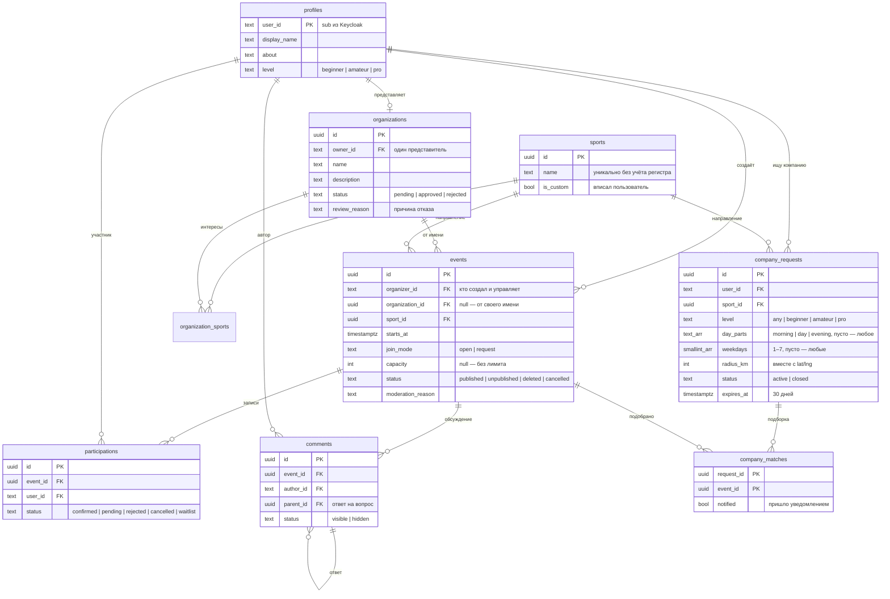

# Модель данных: события, организации, записи, обсуждение

Модель сервиса `server/events` для кейса [«Платформа совместных спортивных активностей»](case.md). Весь домен лежит в одной базе `events`. Статус организации, статус события и запись на него проверяются в одной транзакции, поэтому дробить их по сервисам незачем.

Пользователи живут в Keycloak: идентификатор — `sub` из токена, `X-User-ID`. Сервис хранит только их публичный профиль.

## Схема



Служебные таблицы берём из `server/tasks` без изменений:

- `outbox` — события в RabbitMQ: уведомления и realtime;
- `status_history` — история переходов с причиной и автором.

## Таблицы

### `profiles` — публичный профиль пользователя

| Колонка        | Тип           | Правило                                                                                                                   |
| -------------- | ------------- | ------------------------------------------------------------------------------------------------------------------------- |
| `user_id`      | `text` PK     | `sub` из Keycloak                                                                                                         |
| `display_name` | `text`        | 1–100 символов. При каждом запросе обновляется из `X-User-Name` (upsert), чтобы авторы в обсуждении всегда были с именами |
| `about`        | `text`        | ≤ 1000, необязательно                                                                                                     |
| `city`         | `text`        | Необязательно                                                                                                             |
| `level`        | `text`        | `beginner` \| `amateur` \| `pro`, необязательно. Нужен для подсказки «подходит ли мне»                                    |
| `created_at`   | `timestamptz` |                                                                                                                           |

### `sports` — справочник направлений

| Колонка      | Тип           | Правило                                                                  |
| ------------ | ------------- | ------------------------------------------------------------------------ |
| `id`         | `uuid` PK     |                                                                          |
| `name`       | `text`        | 2–60 символов, уникальный индекс по `lower(btrim(name))`                 |
| `is_custom`  | `boolean`     | `false` — из нашего списка, `true` — вписал пользователь                 |
| `created_by` | `text`        | Кто вписал, `null` для базовых                                           |
| `hidden`     | `boolean`     | Админ может скрыть мусорное название; существующие события его сохраняют |
| `created_at` | `timestamptz` |                                                                          |

**Своё направление без правки кода:**

1. При создании события клиент присылает `sport_id` или `sport_name`.
2. Для `sport_name` сервис выполняет `INSERT … ON CONFLICT (lower(btrim(name))) DO UPDATE … RETURNING id`. «Фрисби» и « фрисби » превращаются в одну запись.
3. Новое направление сразу появляется в фильтре.

### `organizations` — клуб, кружок, федерация, компания

| Колонка         | Тип           | Правило                                                   |
| --------------- | ------------- | --------------------------------------------------------- |
| `id`            | `uuid` PK     |                                                           |
| `owner_id`      | `text`        | Представитель, `UNIQUE`: одна организация на пользователя |
| `name`          | `text`        | 2–120                                                     |
| `description`   | `text`        | Деятельность, ≤ 3000                                      |
| `city`          | `text`        |                                                           |
| `contacts`      | `text`        | Сайт, телефон, ссылка на чат, ≤ 500                       |
| `status`        | `text`        | `pending` \| `approved` \| `rejected`                     |
| `review_reason` | `text`        | Обязательна при `rejected` (`CHECK`), видна представителю |
| `reviewed_by`   | `text`        | Админ                                                     |
| `reviewed_at`   | `timestamptz` |                                                           |
| `created_at`    | `timestamptz` |                                                           |
| `updated_at`    | `timestamptz` |                                                           |

`organization_sports (organization_id, sport_id)` — спортивные интересы организации. Их показывают на странице и по ним фильтруют.

### `events` — конкретная совместная активность

| Колонка             | Тип           | Правило                                                                                         |
| ------------------- | ------------- | ----------------------------------------------------------------------------------------------- |
| `id`                | `uuid` PK     |                                                                                                 |
| `organizer_id`      | `text`        | Пользователь, который создал событие и управляет им. Для события организации — её представитель |
| `organization_id`   | `uuid` null   | `null` — событие от своего имени                                                                |
| `sport_id`          | `uuid` FK     |                                                                                                 |
| `title`             | `text`        | 3–120                                                                                           |
| `description`       | `text`        | ≤ 5000                                                                                          |
| `starts_at`         | `timestamptz` | При создании — в будущем                                                                        |
| `ends_at`           | `timestamptz` | null или `> starts_at`                                                                          |
| `location`          | `text`        | Адрес или понятное описание места (обязательно)                                                 |
| `lat`, `lng`        | `double`      | null; для карты                                                                                 |
| `level`             | `text`        | `any` \| `beginner` \| `amateur` \| `pro`                                                       |
| `requirements`      | `text`        | Подготовка, инвентарь, форма, ≤ 2000                                                            |
| `price_note`        | `text`        | «Бесплатно», «300 ₽ за аренду» и т. п.                                                          |
| `private_info`      | `text`        | Точка сбора, контакты организатора. Видна только подтверждённым участникам и организатору       |
| `join_mode`         | `text`        | `open` \| `request`                                                                             |
| `capacity`          | `int`         | null или ≥ 1                                                                                    |
| `status`            | `text`        | `published` \| `unpublished` \| `deleted` \| `cancelled`                                        |
| `moderation_reason` | `text`        | Обязательна при `unpublished` и `deleted` (`CHECK`)                                             |
| `moderated_by`      | `text`        |                                                                                                 |
| `moderated_at`      | `timestamptz` |                                                                                                 |
| `search`            | `tsvector`    | Генерируемая: `to_tsvector('russian', title ‖ description ‖ location)`, GIN-индекс              |
| `created_at`        | `timestamptz` |                                                                                                 |
| `updated_at`        | `timestamptz` |                                                                                                 |

**Индексы:**

- `(status, starts_at)` — основная выдача;
- `(sport_id, starts_at)`;
- `(organization_id, starts_at)`;
- `(organizer_id)`;
- GIN по `search`.

### `participations` — запись на событие

| Колонка           | Тип           | Правило                                                             |
| ----------------- | ------------- | ------------------------------------------------------------------- |
| `id`              | `uuid` PK     |                                                                     |
| `event_id`        | `uuid` FK     | `ON DELETE CASCADE`                                                 |
| `user_id`         | `text`        | `UNIQUE (event_id, user_id)`: повторная запись не создаёт дубль     |
| `status`          | `text`        | `confirmed` \| `pending` \| `rejected` \| `cancelled` \| `waitlist` |
| `message`         | `text`        | Сопроводительное сообщение к заявке, ≤ 500                          |
| `decision_reason` | `text`        | Комментарий организатора при отказе, необязательно                  |
| `decided_by`      | `text`        |                                                                     |
| `decided_at`      | `timestamptz` |                                                                     |
| `created_at`      | `timestamptz` |                                                                     |
| `updated_at`      | `timestamptz` |                                                                     |

Индекс `(event_id, status)` нужен для списка участников и счётчика мест, `(user_id, created_at DESC)` — для «Моих записей».

### `comments` — обсуждение под событием

| Колонка         | Тип           | Правило                                                                           |
| --------------- | ------------- | --------------------------------------------------------------------------------- |
| `id`            | `uuid` PK     |                                                                                   |
| `event_id`      | `uuid` FK     | `ON DELETE CASCADE`                                                               |
| `author_id`     | `text`        |                                                                                   |
| `parent_id`     | `uuid` null   | Ответ на вопрос (один уровень вложенности)                                        |
| `body`          | `text`        | 1–2000                                                                            |
| `status`        | `text`        | `visible` \| `hidden`                                                             |
| `hidden_reason` | `text`        | Обязательна при `hidden`; вместо текста показываем «Сообщение скрыто модератором» |
| `hidden_by`     | `text`        |                                                                                   |
| `created_at`    | `timestamptz` |                                                                                   |

Бейдж «Организатор» не хранится в таблице, а вычисляется при чтении: `author_id = events.organizer_id`. Если событие от организации, рядом показываем её название.

### `company_requests`, `company_matches` — «Ищу компанию»

Человек, не нашедший подходящего события, описывает направление, свой уровень, удобное время суток и дни, район словами и (необязательно) точку с радиусом. Один активный запрос на направление. Через 30 дней запрос показывается как `expired` и больше не подбирается.

Подбор — одно SQL-условие `companyMatch` (`company_repository.go`) на оба направления:

- направление совпадает, событие опубликовано и не началось, организатор — не автор запроса;
- уровень совместим: `any` с любой стороны или точное совпадение;
- время суток (утро до 12:00, день до 17:00, вечер) и день недели — по местному времени события;
- расстояние (гаверсинус) проверяется, только если точка есть и у запроса, и у события.

При **публикации события** совпадения пишутся в `company_matches` с `notified=true` в той же транзакции, а в outbox ставится «Нашлась компания». При **создании запроса** уже опубликованные события сразу попадают в подборку без уведомлений: человек видит их списком. Организатор видит только обезличенный спрос (`/sports/demand`) и счётчик `company_matches` на событии.

## Статусы и переходы

Переходы описываются таблицей `platform.NewWorkflow`, как в `server/tasks`. Недопустимый переход возвращает 409, а каждый переход пишется в `status_history` в той же транзакции.

**Организация:**

```
(создание) → pending
pending   → approved            админ
pending   → rejected            админ, причина обязательна
rejected  → pending             представитель исправил профиль и подал снова
```

**Событие:**

```
(создание) → published          сразу, без модерации (пользователь или допущенная организация)
published → unpublished         админ, причина обязательна
published → deleted             админ, причина обязательна (мягкое удаление)
published → cancelled           организатор отменил (доп. возможность)
unpublished → published         админ вернул публикацию (доп. возможность)
```

**Запись:**

```
open:     (запись) → confirmed                   или waitlist, если мест нет
request:  (заявка) → pending → confirmed | rejected     решает организатор
confirmed | pending | waitlist → cancelled       пользователь передумал
освободилось место: первый waitlist → confirmed  (доп. возможность)
cancelled | rejected → pending | confirmed       повторная запись обновляет ту же строку
```

**Сообщение:** `visible → hidden`. Скрывает админ, причина обязательна.

## Правила доступа (проверяются в SQL, не в клиенте)

| Действие                                    | Условие                                                                                                                                                                                                                     |
| ------------------------------------------- | --------------------------------------------------------------------------------------------------------------------------------------------------------------------------------------------------------------------------- |
| Создать событие от организации              | `INSERT … SELECT … WHERE EXISTS (SELECT 1 FROM organizations WHERE id=$org AND owner_id=$me AND status='approved')`. Ноль строк — 403 «Организация ещё не допущена»                                                         |
| Записаться                                  | В одной транзакции: `SELECT … FROM events WHERE id=$1 AND status='published' AND starts_at > now() FOR UPDATE`, затем подсчёт `confirmed` против `capacity`. Иначе 409 — это закрывает «нельзя записаться по прямой ссылке» |
| Принять или отклонить заявку                | `UPDATE participations p … FROM events e WHERE p.event_id=e.id AND e.organizer_id=$me AND p.status='pending'`. Админ **не** может: это решение организатора                                                                 |
| Видеть заявки и `private_info`              | Организатор события или запись в статусе `confirmed`                                                                                                                                                                        |
| Видеть событие                              | `published` — все. `unpublished`/`deleted`/`cancelled` — организатор, его участники (с плашкой и причиной) и админ. Остальным 404                                                                                           |
| Писать в обсуждение                         | Любой вошедший пользователь, пока событие `published`                                                                                                                                                                       |
| Модерация (организации, события, сообщения) | `admin`: `RequireRole("admin")` в gateway **и** в сервисе                                                                                                                                                                   |
| Страница организации                        | Публична только при `approved`. Представитель видит свою в любом статусе                                                                                                                                                    |

## API

Источник правды — `server/events/api/openapi.yaml` (Swagger: `/api/docs`, спецификация «events»). Тест `api/spec_test.go` сверяет её с маршрутами в обе стороны. Все пути идут под `/api/v1` через gateway; личные разделы — под `/my`, чтобы не конфликтовать с `GET /me`.

| Метод и путь                                                 | Кто           | Что                                                                                             |
| ------------------------------------------------------------ | ------------- | ----------------------------------------------------------------------------------------------- |
| `GET /sports`                                                | все           | Справочник (без скрытых), базовые первыми                                                       |
| `GET /events?q=&sport=&mode=&level=&from=&to=&organization=` | все           | Выдача: только `published` и не закончившиеся, ближайшие первыми                                |
| `POST /events`                                               | пользователь  | `sport_id` или `sport_name`, поля карточки, `as_organization` — от своей допущенной организации |
| `GET /events/{id}`                                           | все           | Карточка + `my_participation` + `is_organizer`; `private_info` — по правилам выше               |
| `POST /events/{id}/cancel`                                   | организатор   | Отмена с причиной                                                                               |
| `POST /events/{id}/join` · `DELETE /events/{id}/join`        | пользователь  | Записаться или подать заявку (`message?`) · отменить                                            |
| `GET /events/{id}/participants`                              | все           | Организатор и админ — все записи с сообщениями; остальные — подтверждённые участники по имени   |
| `POST /events/{id}/participants/{pid}/approve` · `/reject`   | организатор   | Решение по заявке (`reason?` при отказе)                                                        |
| `GET /events/{id}/comments` · `POST /events/{id}/comments`   | все           | Обсуждение (`parent_id?` — ответ)                                                               |
| `GET /my/participations` · `GET /my/events`                  | пользователь  | Мои записи · мои события во всех статусах                                                       |
| `GET /my/organization` · `POST` · `PUT`                      | представитель | Статус заявки и причина · подать · исправить (после отказа — повторная подача)                  |
| `GET /organizations` · `GET /organizations/{id}`             | все           | Каталог допущенных · страница с ближайшими событиями                                            |
| `GET /profiles/{id}`                                         | все           | Профиль организатора и его ближайшие события                                                    |
| `GET /my/company-requests` · `POST` · `GET/DELETE /{id}`     | пользователь  | «Ищу компанию»: мои запросы · создать (сразу подбираются опубликованные) · открыть · закрыть    |
| `GET /my/company-requests/{id}/matches`                      | пользователь  | Подобранные предстоящие события                                                                 |
| `GET /sports/demand?sport_id=\|sport_name=&level=`           | все           | Обезличенный спрос: сколько ищут, по частям дня и дням недели                                   |
| `GET /admin/organizations?status=&q=`                        | админ         | Очередь заявок (ожидающие первыми) и поиск                                                      |
| `POST /admin/organizations/{id}/approve` · `/reject`         | админ         | Допуск; `reason` обязателен при отказе                                                          |
| `GET /admin/events?status=&q=`                               | админ         | Поиск во всех статусах                                                                          |
| `POST /admin/events/{id}/unpublish` · `/delete` · `/restore` | админ         | Модерация с причиной                                                                            |
| `POST /admin/comments/{id}/hide`                             | админ         | Скрыть сообщение с причиной                                                                     |

**Коды ошибок:**

- **403** — нет прав: организация не допущена, решение по заявке не организатором;
- **404** — нет такого или скрыто от вас;
- **409** — снятое, отменённое, прошедшее или полное событие, повторная заявка организации, запрещённый переход;
- **422** — неверное поле (`field` в ответе) или нет обязательной причины (`reason_required`).

## События в RabbitMQ (outbox)

| Тип                      | Когда                               | Получатели и что происходит                                      |
| ------------------------ | ----------------------------------- | ---------------------------------------------------------------- |
| `notification.requested` | Заявка принята или отклонена        | Участник: колокольчик, почта, MAX                                |
| `notification.requested` | Новая заявка или запись             | Организатор                                                      |
| `notification.requested` | Организация допущена или отклонена  | Представитель, с причиной                                        |
| `notification.requested` | Событие снято, удалено или отменено | Организатор и все `confirmed`/`pending`/`waitlist`, с причиной   |
| `notification.requested` | Ответ на вопрос в обсуждении        | Автор вопроса                                                    |
| `notification.requested` | Опубликовано подходящее событие     | Авторы подходящих запросов «Ищу компанию»: «Нашлась компания»    |
| `realtime.publish`       | Новое или скрытое сообщение         | Канал `room:event:<id>`: обсуждение обновляется без перезагрузки |

Журнал действий пишет `server/audit` автоматически: gateway публикует `audit.recorded` для каждого изменяющего запроса.

## Демо-данные (`fixtures/events.json`, `make seed`)

Сид создаёт всё через API, поэтому срабатывают те же проверки и уведомления, что у живых пользователей. Время событий считается от момента сида по Красноярску, поэтому демо не устаревает. Повторный запуск ничего не дублирует.

- **Организации:**
  - «Шахматный клуб „Ладья“» — `approved` (Олег, `org`);
  - «Клуб скандинавской ходьбы „Сосны“» — `pending` (Мария, `org_pending`);
  - «Фитнес-студия „Пульс“» — `rejected` с причиной (Пётр, `org_rejected`).
- **Мероприятия:** 9 штук, 8 направлений, оба режима. Среди них:
  - своё направление «Воркаут»;
  - пробежка с лимитом 2 места, уже заполненная, — следующий попадает в лист ожидания;
  - турнир «Ладьи» по заявке с закрытой информацией;
  - «Продам абонемент в зал», снятое админом с причиной.
- **Заявки:**
  - две `pending` на турнир «Ладьи» от Игоря и Петра — для сценария 4;
  - заявка на йогу Анны;
  - принятая и ожидающая заявки на футбол.
- **Обсуждение:**
  - вопрос Анны и ответ организатора на турнире;
  - вопрос Петра и ответ Игоря на пробежке;
  - рекламное сообщение, скрытое модератором.
- **Ищу компанию:** Анна — бег для новичков по утрам (сразу подобрана пробежка вдоль Енисея) и скалолазание впервые; Игорь — шахматы по вечерам; Олег — напарник на скалодром; Мария и Пётр — бег. Демо: Игорь создаёт утреннюю пробежку и видит спрос, Анне приходит «Нашлась компания».
